<Note>
  Looking to put a video, a form or another web page inside a flow step? That is the **Embed**
  content block — see [Embed any content](/how-to-guides/embed). This page is about the **Embeds**
  content type: cards that live in your app's layout.
</Note>

## What is an embed?

An embed is a card that lives inside your app's page, at an element you choose. It is not a popup
and it does not float over the page: it sits in the layout, next to or inside your own components,
and the page flows around it.

You can use embeds to:

- **Upsell and gate features** — Cover a locked chart or report with an "Upgrade to Pro" card
- **Announce in context** — Put a "what's new" card right in the area the feature lives
- **Fill empty states** — Show a getting-started card where the list is still empty
- **Ask in place** — Run a short inline survey where the answer is on the user's mind
- **Run campaigns** — Promote a webinar or an offer in a dashboard sidebar

Two things set embeds apart from banners. **Several embeds can show at once**: every embed a user
qualifies for renders, each at its own element. And an embed can have **several steps**, paged
inside the same card, so a short guide can live in place without opening a flow.

## Creating an embed

1. Click **Embeds** in the left sidebar
   {/* Screenshot: the Embeds list page, with the left sidebar entry highlighted. */}
   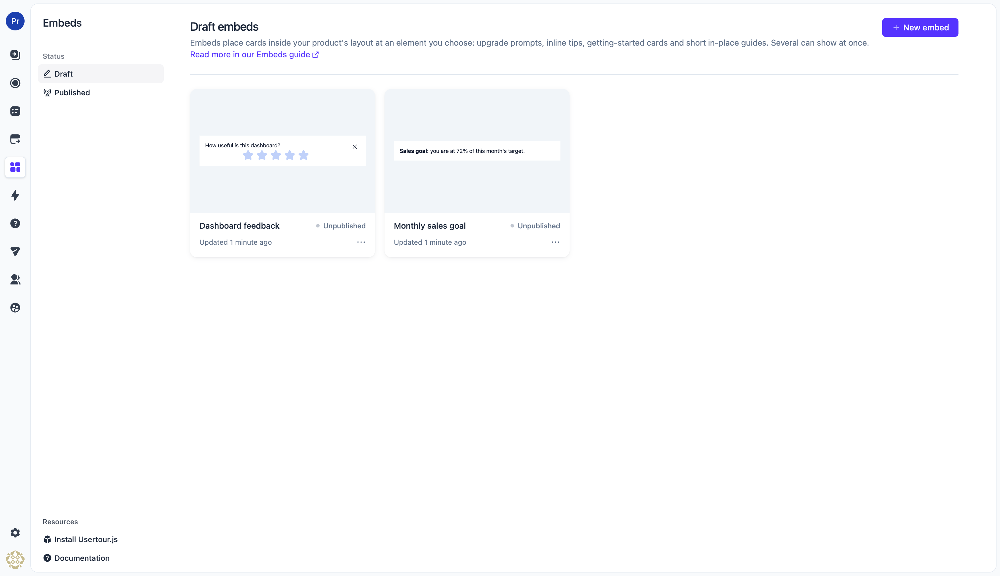
2. Click **Create embed**
3. Enter a name for your embed and click **Submit**
   {/* Screenshot: the create dialog with a name filled in. */}
   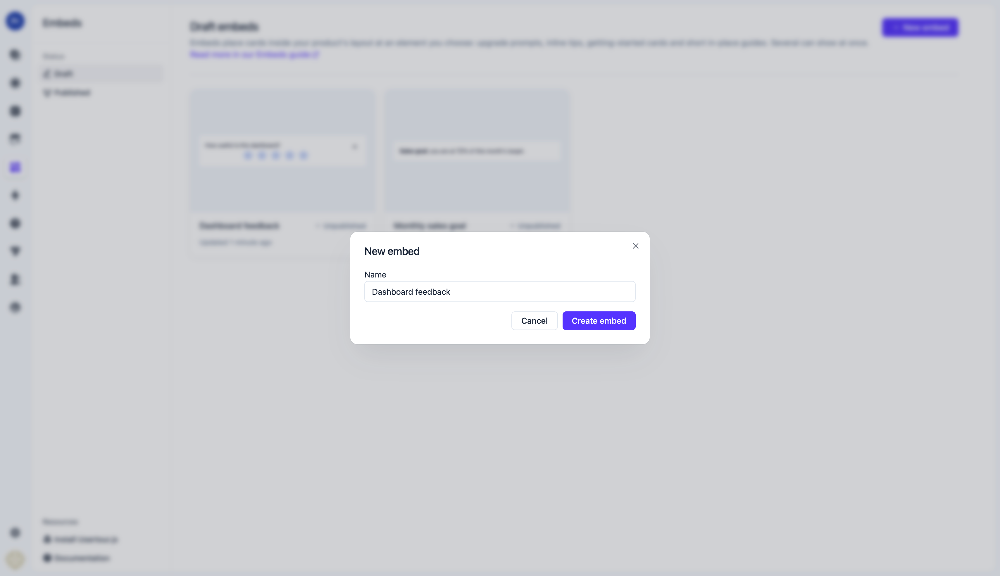
4. The editor opens with the preview on the right and the settings panel on the left
   {/* Screenshot: the embed editor — settings panel on the left (Theme, Placement, Steps, Layout, Settings), preview on the right. */}
   

The left panel reads top to bottom in the order you usually work: the theme, where the embed
goes, its steps, and then layout and settings you set once.

## Choosing where it shows

Every embed is placed relative to one element of your page: its **target**. Pick the placement
first, then point the embed at the element.

### Placement

- **Top of container element** — Inside the element, as its first child
- **Bottom of container element** — Inside the element, as its last child
- **Immediately before element** — As a sibling, right above the element
- **Immediately after element** — As a sibling, right below the element
- **Cover element** — Over the element, sized to it. The element stays in the page underneath

{/* Screenshot: the Placement dropdown open, showing the five options. */}
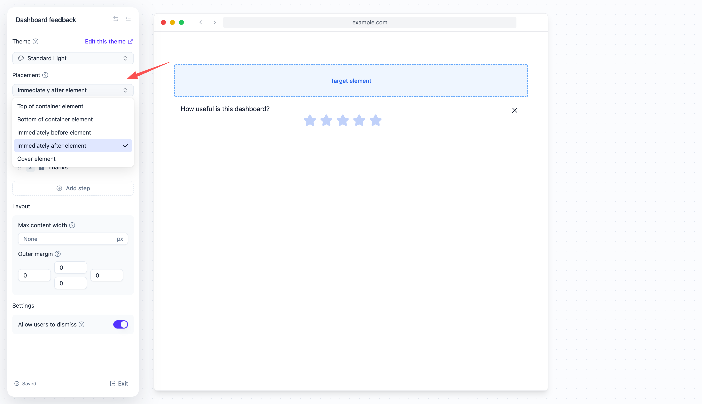

The first four placements insert the card into the document flow, so your page makes room for it.
**Cover element** does not take space: the card is laid over the element and follows it when the
page scrolls or resizes. The card is placed inside the element; if the element has no `position` of
its own, the SDK gives it `position: relative` while the cover shows. The element's content is not
touched.

<Warning>
  A cover **places content; it does not gate access**. Your app still renders the element
  underneath and still enforces its own permissions. Use the cover for the message, and keep the
  real check in your product.
</Warning>

### Target element

Click the **Target** row under the placement to open the target settings, and enter a CSS selector
that matches exactly one element. If the element has no stable selector, add an `id` or a `data-*`
attribute to it in your app — see [Selecting elements](/how-to-guides/selecting-elements).

{/* Screenshot: the Target settings view with a selector entered. For a cover placement, the Z-index field is visible below it. */}
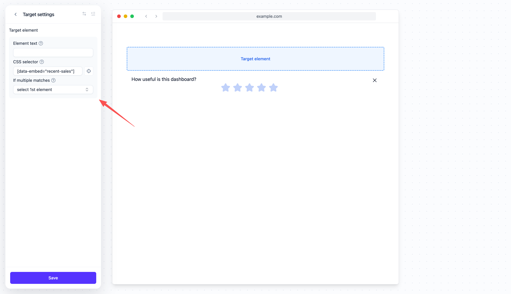

For a cover, the same view has two more settings:

- **Z-index** — Stacking order of the cover above your page. Leave it empty for the default
- **Content position** (back in the Placement section) — Where the content sits inside the covered
  area: **Top**, **Center** or **Bottom**. The cover is as tall as the element it covers, so the
  content has room to move. Center is the default

{/* Screenshot: a cover embed over a chart card in a real app — "Upgrade to Pro" card filling the chart's box, content centered. */}
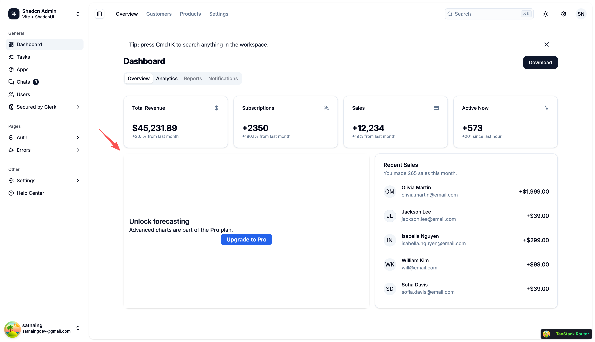

The embed shows only while the target element exists on the page. If the element goes away — the
user switches a tab, navigates to another view — the embed goes with it, and comes back when the
element does.

## Adding steps

An embed's content lives in **steps**, the same building blocks a flow uses. Most embeds have one
step. Use more when you want the card to page through something in place: a two-screen "what's
new", a question followed by a thank-you, a short guide.

1. In the **Steps** section, click **Add step** and pick a kind:
   - **Inline** — A step the user sees, rendered inside the card
   - **Hidden** — No UI; a step that only runs triggers, for routing between steps
2. Click a step to edit its content in the preview on the right
3. Type your text directly into the preview. Click the **+** button to add buttons, images, or a
   question — one question per step

{/* Screenshot: the Steps section with two steps listed and the Add step button. */}
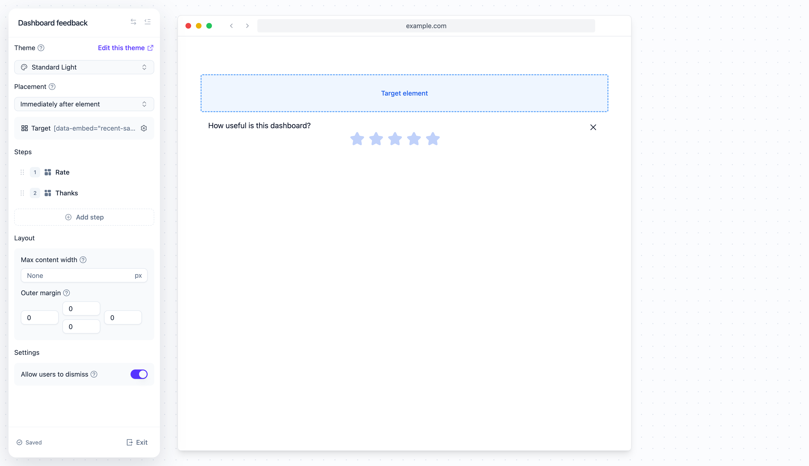

### Button actions

When someone clicks a button, you can:

- **Go to step** — Move to another step of this embed, by name
- **Dismiss embed** — Close the card
- **Navigate to page** — Send them somewhere specific
- **Start new flow** — Launch a flow or a checklist

{/* Screenshot: the button action menu in the content editor, with "Go to step" expanded. */}
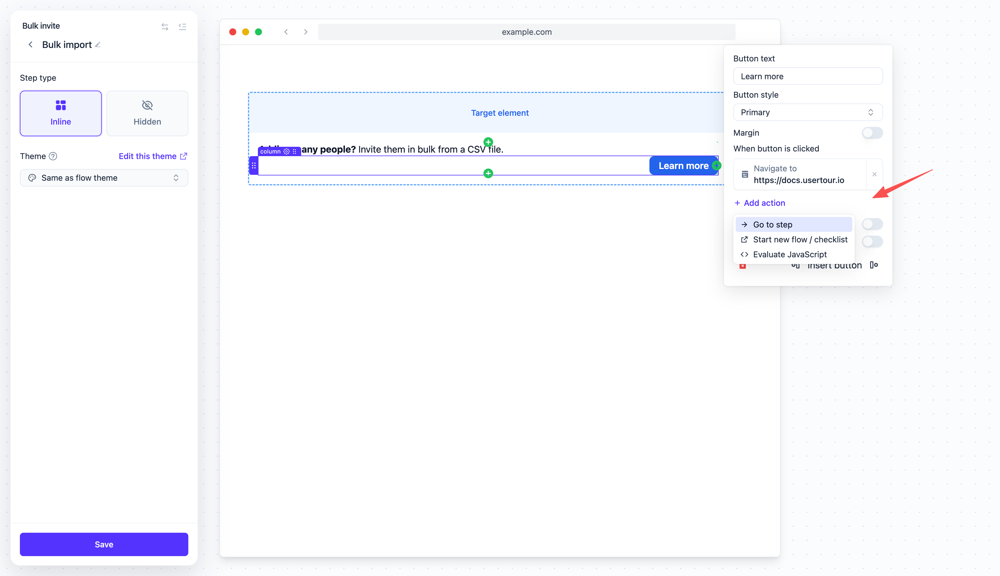

Every button click is recorded, so you can see later which button people pressed.

## Layout and settings

- **Max content width** — Caps the width of the content column, in pixels. Leave it empty to fill
  the embed
- **Outer margin** — Space between the embed and the surrounding content, on each side
- **Allow users to dismiss** — Shows a close button. Dismissing ends the current session; whether
  the embed shows again is decided by its frequency, below

{/* Screenshot: the Layout and Settings sections of the left panel. */}
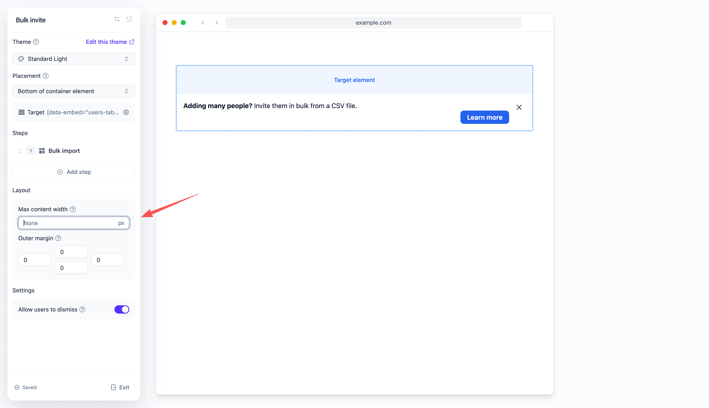

Click **Save** when you are done.

## Deciding who sees it

Back on the embed's page, open **Settings** and set the rules under **Show embed if…**. These work
like start rules do elsewhere — see [How start rules work](/how-to-guides/how-start-rules-work) —
with one difference worth knowing:

**The rules are checked continuously, not just once.** The embed is visible while the user matches
them and the target element exists, and it disappears the moment either stops being true. A user
on the free plan sees the upgrade card; the moment the plan changes, the card is gone, with no
dismiss and no reload. If the user qualifies again later, the card comes back on the step it was on.

There are no separate hide rules. "Show if A, hide if B" is simply "show if A and not B".

{/* Screenshot: the Settings page of an embed with a "Show embed if…" rule on a company attribute and the frequency control below it. */}
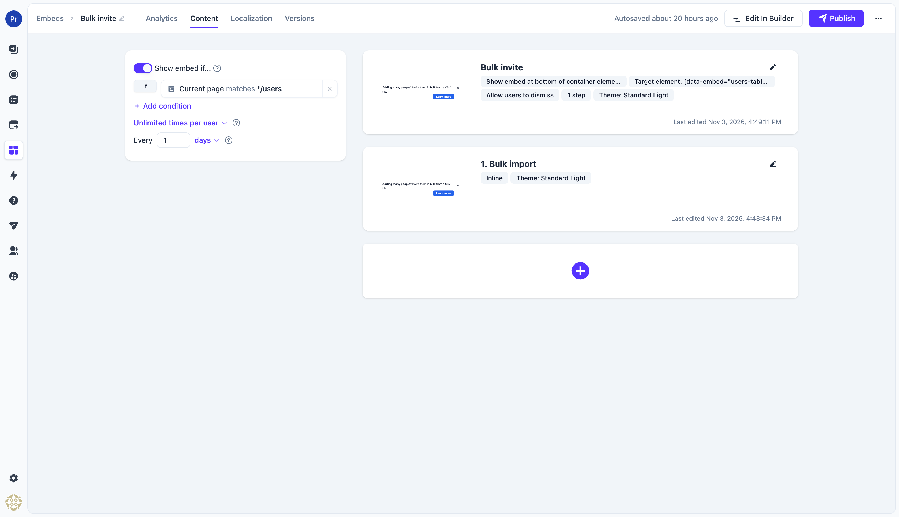

### Frequency

The frequency setting decides what happens after the user dismisses the embed:

- **Once per user** — Dismissing is final; the embed never shows again for that user
- **Unlimited times per user** — The embed may come back once the gap you set has passed since the
  dismissal, as long as the rules still match. One day is the default
- **Multiple times per user** — The same gap, plus a cap on the total number of times the embed may
  show for that user

The gap is measured from the moment the previous session ended. A gap of zero means the embed is
back at the next check while the rules match, so the close button has no lasting effect — pick a
gap that fits the message.

## Several embeds at once

Every embed whose rules match shows at the same time, each at its own element. Several embeds can
even share one element: they stack in the order they were delivered. There is no priority between
embeds and nothing to arbitrate — if you want one card instead of two, give them rules that do not
overlap.

## Styling embeds

Embeds take their look from the theme. In the theme editor, the **Embed** section sets the card's
**Background color** and **Text color**; the default background follows the theme's main color, so
the card looks like part of your page rather than a brand-colored banner. Padding and borders come
from the shared settings of the theme.

{/* Screenshot: the theme editor with the Embed section open and the embed preview visible. */}
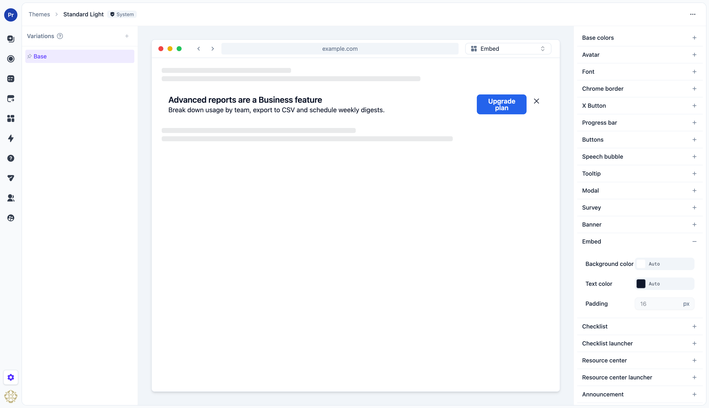

## Measuring embeds

The embed's **Analytics** tab shows:

- **Unique views** — People the embed started showing for in the selected date range. Someone it
  comes back to after being dismissed counts again when it comes back
- **Unique clickers** — People who pressed any button in the selected date range
- **Dismissals** — People whose embed ended in the selected date range: they closed it, or it was
  unpublished or ended for them

Below the headline numbers, a table per step shows how many users reached each step, and a table
per button shows the clicks on each button. An embed is counted once each time it starts showing
for someone; impressions are not counted, since a card that lives in the page is seen on every visit.

{/* Screenshot: the Analytics tab of an embed with the headline cards, the trend chart and the step table. */}
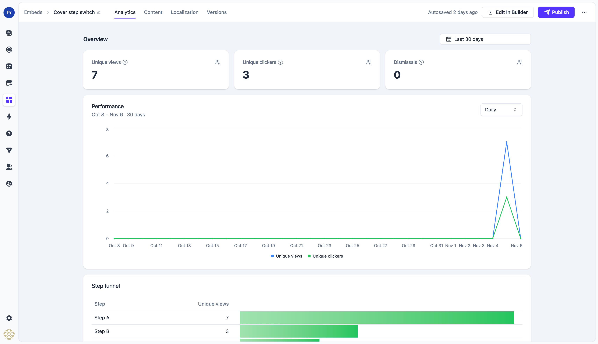

## Requirements

Embeds are delivered by the Usertour.js bundle that ships with this release (0.8.2 or later). On
Usertour Cloud that is automatic. On a self-hosted instance, upgrade to the server release that
introduces embeds; the bundle is served by your own instance and upgrades with it.
