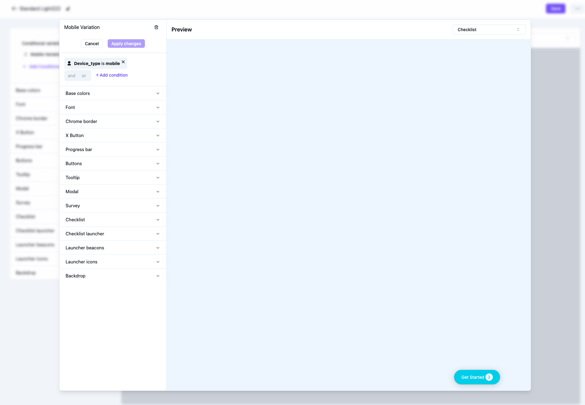
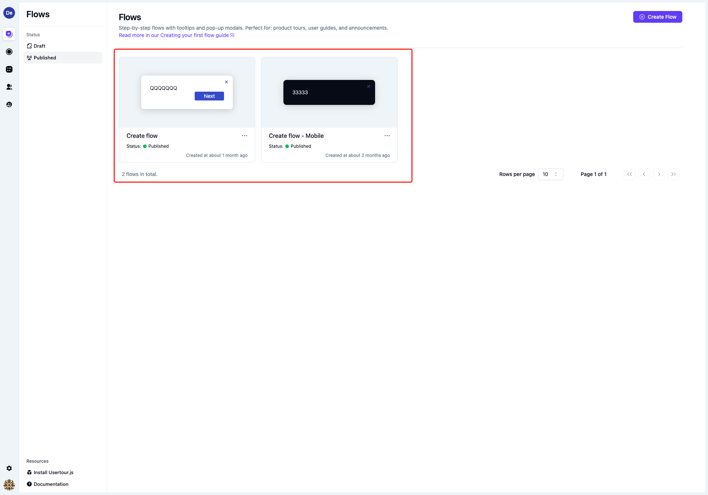
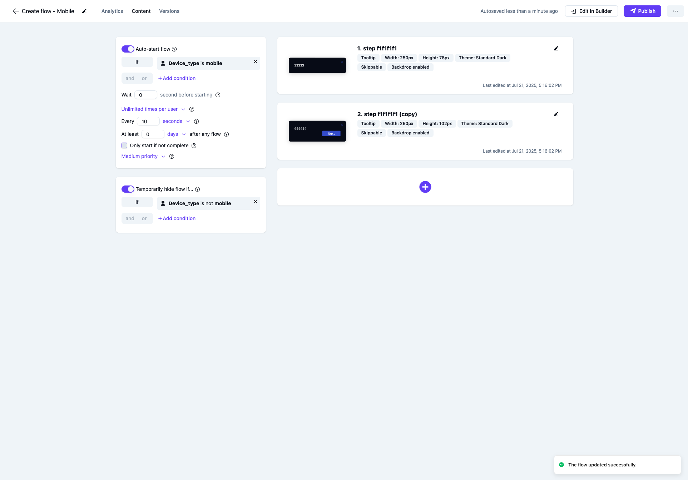

While Usertour does not support native mobile apps (e.g., native iOS or Android), it does support mobile web apps.

Use the `device_type` user attribute to adapt Usertour content to your mobile web layout.

- Use **Theme Variations** to adjust the appearance of the same content, such as making a checklist launcher smaller on mobile.
- Use **auto-start rules** to show different flows on mobile and desktop when the steps or the elements they target differ between layouts.

## Recognizing if a user is on mobile

Pass `device_type` as a custom user attribute when you call `usertour.identify()`. This example uses the browser viewport width to determine which layout is active.

```javascript
usertour.identify(userId, {
  //...
  device_type: window.innerWidth > 800 ? 'desktop' : 'mobile'
})
```

This example sends `mobile` for viewports up to 800 pixels wide and `desktop` for wider viewports. Use the breakpoint that matches your app's layout.

## Smaller checklist launchers for mobile

Use a conditional theme variation to change the size of a checklist launcher on mobile while using the same checklist on both layouts.

1. Go to **Settings** > **Themes** and open the theme your checklist uses.
2. Add a conditional variation with a **User attribute** condition that matches when `device_type` is `mobile`.

   

3. Reduce the width in the **Checklist launcher** section of the variation, apply the changes, and save the theme.

For flow steps, set the width to **Auto** to use the theme variation’s width. A width explicitly set on a step takes priority over the theme.

## Separate flows based on device type

If mobile and desktop layouts need different steps or target elements, create a flow for each layout. The same rules work for separate mobile and desktop checklists.

1. Create a mobile flow and a desktop flow, and configure each one's steps for the corresponding layout.

   

2. On each flow's detail page, enable **Auto-start flow** and add a **User attribute** condition. Set `device_type` to match `mobile` for the mobile flow and `desktop` for the desktop flow. Add a temporary hide rule if an active flow should hide when `device_type` changes to the other value.

   

3. To show only one version per user across both layouts, add an **AND** condition to each auto-start rule requiring that the other flow has not been seen.

   

## Disabling Usertour completely on mobile

If you want to completely disable Usertour on mobile, you would need to remove the Usertour.js snippet from the mobile view. Then the users won't be registered and no content will be served.


